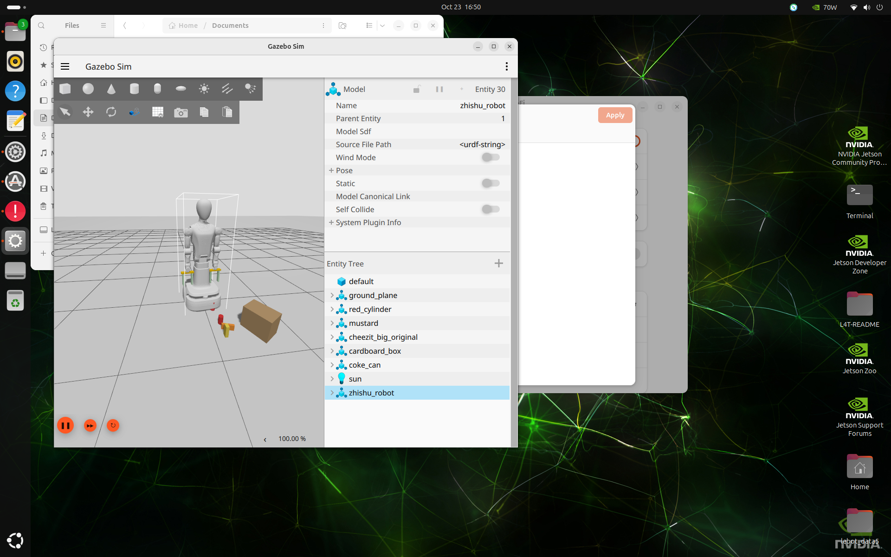
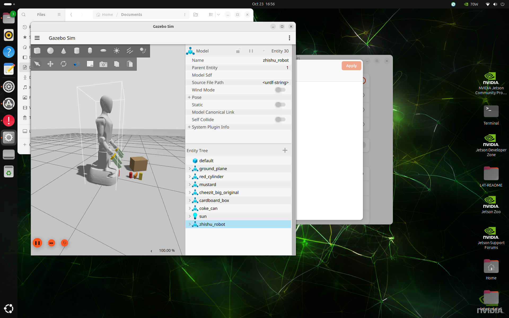

# Gazebo / 假硬件 回 Home 验证（2026-10-23）

## 结论

- `zhishu_robot_sdk_cpp` 的统一双臂 Home（`setHomePose()` / `moveHome()`）在 Jetson 上完成仿真验证：
  假硬件下按 14 关节回放，落地构型与保存值最大偏差 **0.000099 rad（约 0.006°）**；Gazebo 里同样可执行，
  画面能看到手臂回到保存的构型。
- 之前 Gazebo 起不来、`rviz2` 崩溃、`create` 一直等 world，**都与 Home 代码无关**，是三个环境问题：
  SSH 会话没有 `DISPLAY`、`ros2 launch` 只按 basename 匹配文件、Gazebo 里节点缺少 `use_sim_time`。

## 环境

| 项 | 值 |
| --- | --- |
| 主机 | `dky02`（Jetson，Linux 6.8.12-tegra，aarch64） |
| 系统 | Ubuntu 24.04 + ROS 2 Jazzy |
| 显示 | `DISPLAY=:1`，HDMI-0 1920×1200，NVIDIA Tegra（OpenGL 4.6） |
| Gazebo | Gazebo Sim 8.15.0（`gz_ros2_control`） |
| 工作区 | `/home/dky/Documents/zhishu1-jazzy`（无 `.git`，按文件同步） |
| 连接方式 | dsh-ssh-remote 密钥登录（`~/.ssh/id_ed25519_arm`） |

## 三个问题与修复

1. **SSH 没有 `DISPLAY`**：`XDG_SESSION_TYPE=tty` 时启动 `gz sim`（带 GUI）会初始化失败退出，
   `ros_gz_sim create` 于是反复打印 `Requesting list of world names`，`rviz2` 以 `-6` 退出。
   修复：`export DISPLAY=:1`（本机物理屏）或 MobaXterm 开启 X11-Forwarding（`DISPLAY=localhost:10.x`）。
2. **`ros2 launch <pkg> test/xxx.launch.py` 找不到文件**：Jazzy 的 `ros2launch` 只在 share 目录里按
   **文件名**搜索。修复：改用 `ros2 launch zhishu_robot_sdk_cpp commander_fake_validation.launch.py`
   （或传安装后的绝对路径）；文档已在 `SDK_ACCEPTANCE.md` 更正。
3. **Gazebo 里必须 `-p use_sim_time:=true`**：否则 SDK 节点用系统时间，读不到仿真关节/位姿反馈。
   旧行为会写出全零位姿记录；现在 `setHomePose()` 直接返回 `kNotReady`：
   `current arm joint state is unavailable (0 of 14); in simulation also set use_sim_time:=true`。

## 代码改动

| 提交 | 内容 |
| --- | --- |
| `c203cbf` | 新增 `sdk_home_example`（`mode:=check/save/move`，默认不运动，带 `timeout_sec` 取消） |
| `e9946a6` | 修正 `SDK_ACCEPTANCE.md` 的 fake validation 启动命令 |
| `4c5e408` | Home 记录同时保存 14 关节 + 双末端位姿；`moveHome()` 优先 `moveJoints()`，旧位姿记录回退 `moveBothPoses()` |
| `60fe88d` | 关节反馈不可用时 `setHomePose()` 拒绝写记录；文档补充 `use_sim_time` 要求 |

记录格式（`$HOME/.ros/zhishu_robot_sdk_cpp/home_pose.json`，JSON version 1）：

```json
{
  "version": 1,
  "captured_at": "2026-10-23T08:28:50Z",
  "joints": {"left": [0, 0, 0, 0.7, 0, 0, 0], "right": [0, 0, 0, 0.7, 0, 0, 0]},
  "left":  {"frame_id": "base_footprint", "position": {"x": 0.0062, "y": 0.2250, "z": 0.5480},
            "orientation": {"x": 0.0, "y": -0.0006, "z": 0.0, "w": 1.0}},
  "right": {"frame_id": "base_footprint", "position": {"x": 0.0061, "y": -0.2250, "z": 0.5480},
            "orientation": {"x": 0.0, "y": -0.0005, "z": 0.0, "w": 1.0}}
}
```

`moveHome()` 选择路径的顺序：有 `joints` → `moveJoints()`；只有位姿（旧记录）→ `moveBothPoses()`；
无记录 → SRDF 内置 `both_arms_home`。

## 验证数据

| 场景 | 命令 | 结果 |
| --- | --- | --- |
| 单元测试 | `colcon test --packages-select zhishu_robot_sdk_cpp` | 9/9 通过，`test_home_pose` 10/10 |
| 假硬件：无记录回 Home | `mode:=move` | `Completed both_arms_home`，planning 0.11 s / 执行 10.2 s，肘 0.7→0.0011 |
| 假硬件：采点 | `mode:=save` | 写入 14 关节 + 双末端位姿（`frame_id: base_footprint`） |
| 假硬件：关节回放 | 先经桥接收到 `both_arms_pose1`，再 `mode:=move` | `Completed both arms joint target`，执行 10.2 s，构型最大偏差 **0.000099 rad** |
| 旧位姿记录回退 | `-p home_pose_file:=<无 joints 的记录>` | `Completed both-arm pose target`（`moveBothPoses`） |
| Gazebo：采点/回放 | 加 `-p use_sim_time:=true` | `mode:=save` 记录正常；`mode:=move` 成功，画面见下方截图 |
| Gazebo：缺 `use_sim_time` | `mode:=save` 不带该参数 | `kNotReady`，不再写全零记录 |

截图（Gazebo，`DISPLAY=:1`）：

- 执行前（内置 home，手臂伸直）：`output/gazebo_home_demo/gazebo_before_save.png`
- `moveHome` 后（关节回放到保存构型，肘 0.7）：`output/gazebo_home_demo/gazebo_after_movehome.png`





## 复现命令

```bash
# 终端 A：Gazebo（画面在 :1，也可用 MobaXterm X11 转发）
cd ~/Documents/zhishu1-jazzy
source /opt/ros/jazzy/setup.bash && source install/setup.bash
export DISPLAY=:1
ros2 launch zhishu_robot_gazebo zhishu_robot.gazebo_moveit.launch.py use_rviz:=false
ros2 control list_controllers               # 等 ~25 s：5 个控制器 active

# 终端 B：Home（Gazebo 必须带 use_sim_time）
ros2 run zhishu_robot_sdk_cpp sdk_home_example --ros-args -p use_sim_time:=true -p mode:=check
ros2 run zhishu_robot_sdk_cpp sdk_home_example --ros-args \
  -p use_sim_time:=true -p mode:=save -p execute_motion:=true
ros2 run zhishu_robot_sdk_cpp sdk_example --ros-args -p use_sim_time:=true -p execute_motion:=true
ros2 run zhishu_robot_sdk_cpp sdk_home_example --ros-args \
  -p use_sim_time:=true -p mode:=move -p execute_motion:=true
```

假硬件（无 Gazebo、无显示需求）：

```bash
export ROS_DOMAIN_ID=169
ros2 launch zhishu_robot_sdk_cpp commander_fake_validation.launch.py
# 另一终端，同一 domain：
ros2 run zhishu_robot_sdk_cpp sdk_home_example --ros-args -p mode:=save -p execute_motion:=true
ros2 run zhishu_robot_sdk_cpp sdk_home_example --ros-args -p mode:=move -p execute_motion:=true
```

## 注意事项

- **跨进程要串行**：SDK 的互斥只在同一个 `RobotSdk` 实例内。桥接节点与 `sdk_home_example` 是两个进程，
  必须等上一个动作在 `status_structured` 里 `success: true` 后再发下一个，否则 MoveIt 报
  `execution failed (code -4)`。
- **位姿回放不等价于同构型**：7 自由度冗余臂的 IK 多解，只回放末端位姿时末端可差 <0.1 mm，但肘部可从
  0.001 rad 解到 0.33 rad。因此以 `joints` 为权威数据；位姿仅作兼容与校验。
- Gazebo 日志里的 `libEGL warning: failed to create dri2 screen` / `ZINK` 是回落软件渲染的提示，
  不影响显示，帧率一般。
- 镜像状态：GitHub `mrisD/zhishu1` 与 Gitee `DloveYY/zhishu1` 均已同步到本报告所在提交
  （`c2db045`）；后续每个提交需要分别 `git push github jazzy` 和 `git push gitee jazzy`。
- Jetson 工作区 `/home/dky/Documents/zhishu1-jazzy` 没有 `.git`，当前靠文件同步（本次用 tar 覆盖）；
  需要长期维护时建议在该目录 `git init` 并跟踪 Gitee 远端。
